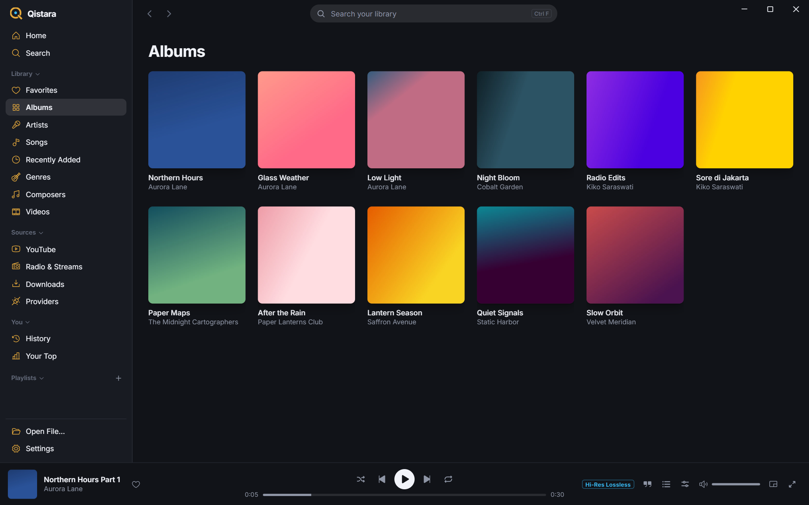
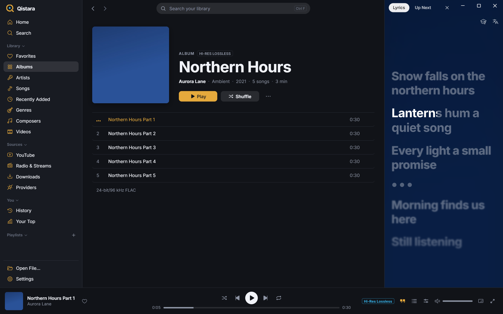
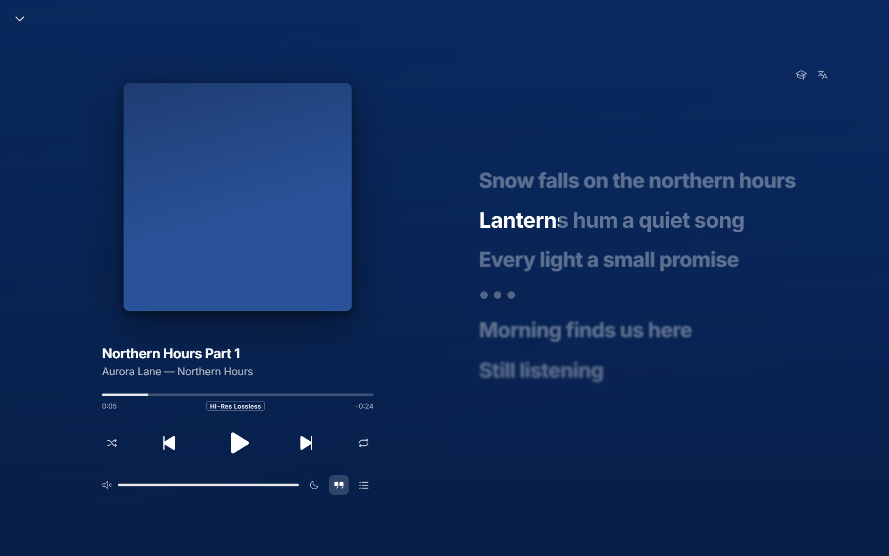
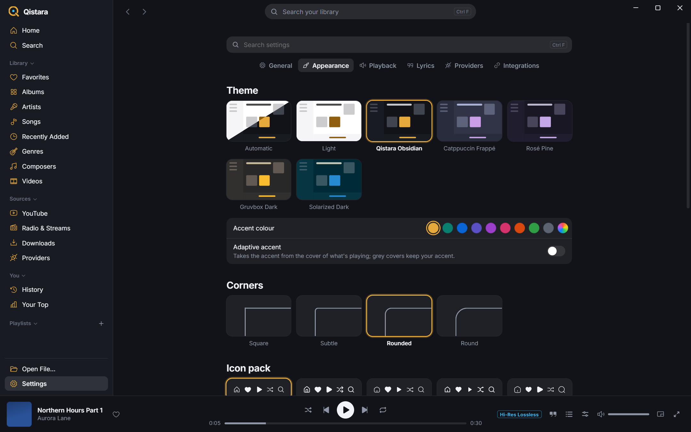
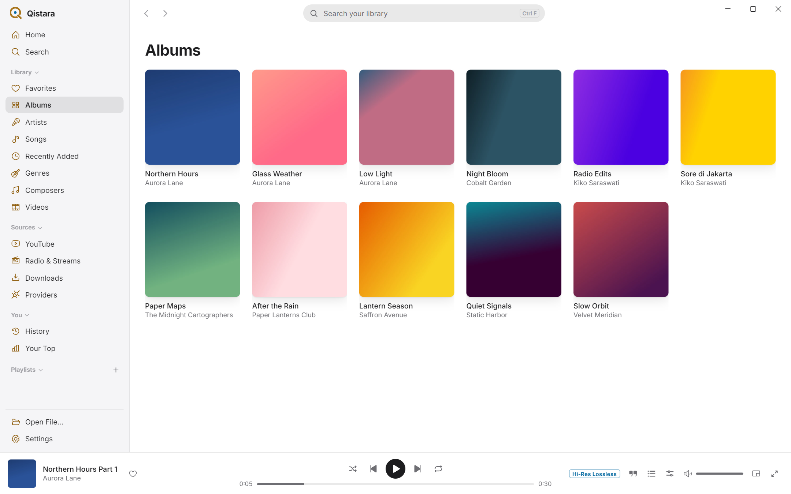

# Qistara

A lossless music and media player for Windows (macOS and Linux build from source) that keeps your music in true
balance: what reaches your DAC is what is in the file. Your files, your music server and YT Music in one place, and
friends listening along.
Built with [Tauri 2](https://tauri.app), [Svelte 5](https://svelte.dev) and [libmpv](https://mpv.io).



## Features

- **Bit-perfect audio.** Exclusive output at each file's own sample rate and bit depth, on by default: WASAPI
  exclusive on Windows, CoreAudio hog mode on macOS, an ALSA `hw:` device on Linux.
  A Signal Path view shows every step from file to DAC and says when something changes the sound.
- **Plays almost anything.** FLAC, ALAC, WAV, AIFF, APE, WavPack, DSD (as PCM), Opus, MP3, AAC and more.
  Video works like VLC: subtitles, audio tracks, chapters, speed, A-B loop, frame step, screenshots, resume.
- **Library.** Watched folders, plus Home, Albums, Artists, Genres, Composers, Songs, Videos, History and search.
  Albums pinned to the sidebar, Lossless and Hi-Res badges, and a duplicate finder.
- **Playback.** Gapless queue with Up Next, shuffle, repeat and Autoplay. A player bar, a lyrics and Up Next pane
  beside the library, full-screen Now Playing, MiniPlayer, sleep timer, media keys, and scroll-wheel volume.
- **Lyrics.**
  - Synced lyrics from TTML, LRC, embedded tags, your Navidrome/Subsonic server, [LRCLIB](https://lrclib.net),
    NetEase or Kugou, asked in the order you set, with word-by-word highlight (and an option to prefer word timing).
  - Translation under each line.
  - Learn mode: tap a word for its meaning. Japanese also gets furigana, romaji and a vocabulary review.
  - Qur'an: recitations are recognised by their titles (surahs, Juz 'Amma, Hafs or Shu'bah). Uthmani text with
    word meanings, transliteration and the Kemenag, Saheeh International and Clear Quran translations, the ayah
    being recited kept in view, and words saved to Vocabulary. In English or Indonesian, with Kemenag surah names
    and Indonesian titles (`QS`, `murotal`) recognised.
- **Organise.** Smart playlists, ratings, Loved, play stats (Your Top), M3U8 import and export.
- **Tag editor.** Safe writes (copy, write, verify, then replace), with MusicBrainz and Cover Art Archive lookup.
- **Parametric EQ.** A response curve you work in directly, a table of every band, and AutoEQ / Equalizer APO
  preset import.
- **Appearance.** Light, Qistara Obsidian or automatic, plus 17 theme families with light and dark variants (Pastel,
  Moonbloom, Timber, Sundial, Fjord, Neon City, Ukiyo, WibuFest and more), an **adaptive theme** that colours the
  whole app from the playing cover; nine accent colours or your own, or one taken from the playing cover; five icon packs; corners from square
  to round; text size, compact rows, Inter or Segoe UI, Mica and blur on or off, and which sidebar items show.
  Settings has tabs and a search (Ctrl+F). The layout fits windows down to 360 px wide and works by touch.
- **Listen together.** Host a session from your PC and send the invite: friends on your network or VPN hear the
  same song at the same moment, your own files included, and chat beside it. End-to-end encrypted.
- **Discord.** Show what you're listening to on your Discord profile (off until you turn it on).
- **Sources (Providers), all optional.**
  - **YT Music** without an account: Home, search, albums, artists, playlists and radio.
  - **Navidrome / Subsonic:** browse and stream your own server; FLAC streams as stored, so it stays bit-perfect.
  - **YouTube:** search, play and download through [yt-dlp](https://github.com/yt-dlp/yt-dlp), as a guest or
    signed in with Firefox's cookies or a cookies.txt file (for Liked Music and Premium audio).
  - **Spotify, Apple Music, Tidal:** import your playlists as playlists of your own files, plus a Spotify Connect
    remote. Their streams are DRM-protected, so they never play or download here.
  - Last.fm scrobbling and internet radio ([Radio Browser](https://www.radio-browser.info)).
- **Downloads.** Paste links (videos, songs, playlists, channels) and pick Video (best down to 240p) or Audio
  (original, M4A, MP3 320/192/128), with each size shown for a single link, into a folder that joins your library.
  yt-dlp, ffmpeg and Deno (YouTube needs a JavaScript runtime) come from their official GitHub releases and are
  checked against the release's SHA-256 list; an ffmpeg or Node.js 20+ already installed is used.
  Download only what you have the right to keep.

## Screenshots

| | |
|---|---|
|  |  |
| An album, with lyrics highlighted word by word | Now Playing |
|  |  |
| The Signal Path: every step from file to DAC | Parametric EQ, with AutoEQ import |
|  |  |
| Settings, with tabs and search | The light theme |

The screenshots show the demo library that `scripts/make-test-media.sh` makes: the artists are made up.

## Documentation

- [User guide](docs/user-guide.md): every feature, the Signal Path, lyrics sources, accounts, shortcuts and troubleshooting.
- [How Qistara is built](docs/architecture.md): the parts, how playback and data work, and the rules that keep it safe.
- [Contributing](CONTRIBUTING.md), [Security policy](SECURITY.md) and [Changelog](CHANGELOG.md).

## Install

Download `Qistara_x.y.z_x64-setup.exe` from [Releases](https://github.com/Schongli/Qistara/releases) and run it.
- **Requirements:** 64-bit Windows 10 or 11. macOS and Linux: build from source (below).
- **Windows warning:** until code signing is set up ([docs/code-signing.md](docs/code-signing.md)), Windows shows "Windows protected your PC". Choose **More info → Run anyway**.
- **Updates:** Settings › General › Updates checks once a day and installs signed updates when you choose to.

## Build from source

You need:
- [Node.js](https://nodejs.org) 22 or newer and [Rust](https://rustup.rs) (stable)
- Windows 10/11 x64: Visual Studio Build Tools with the "Desktop development with C++" workload
- macOS: Xcode command line tools and `brew install mpv`
- Linux: `libwebkit2gtk-4.1-dev libdbus-1-dev build-essential pkg-config libmpv2` (Debian/Ubuntu names)

```bash
npm install
npx tauri-plugin-libmpv-api setup-lib   # Windows: puts libmpv-2.dll and libmpv-wrapper.dll in src-tauri/lib
                                        # macOS/Linux: mkdir -p src-tauri/lib && touch src-tauri/lib/.placeholder
npm run tauri dev                       # run the app
npm run tauri build                     # installer in src-tauri/target/release/bundle/nsis
```

On macOS and Linux, `tauri dev` uses the system libmpv; packaged installers for them aren't set up yet. The Japanese
dictionary isn't part of the build: Learn mode downloads it when first used. Phones: [docs/mobile.md](docs/mobile.md).
Releases: [docs/code-signing.md](docs/code-signing.md).

Tests: `npx vitest run` and `cargo test --lib --manifest-path src-tauri/Cargo.toml`. More in [CONTRIBUTING.md](CONTRIBUTING.md).
`bash scripts/make-test-media.sh` (needs ffmpeg) makes test files: hi-res FLAC tones, an HEVC 10-bit video with subtitles,
and a small tagged library.

## Privacy

Qistara has no account, no telemetry and no servers of its own. It only contacts these services, and only for the features that need them:

| Service | When | What is sent |
|---|---|---|
| LRCLIB | a song has no local lyrics | title, artist, album, length |
| NetEase Cloud Music, Kugou | you turn them on in Settings › Lyrics and a song has no lyrics higher in the list | title, artist, length |
| MusicBrainz, Cover Art Archive | you look up tags or artwork | album and artist |
| Google Translate | you turn on translation or Learn mode | the lyric lines, or the one word you tap |
| Radio Browser | you search for stations | your search text |
| quran.com, GitHub (fawazahmed0 quran-api) | a Qur'an recitation plays | the surah number |
| YouTube (through yt-dlp) | you search, play or download | your search text or link; your cookies only if you sign in |
| YT Music (music.youtube.com) | you browse or search YT Music | your search text, or the album, artist or playlist id; no cookies, no account |
| GitHub releases | you install or update yt-dlp, ffmpeg or Deno; the daily update check (can be turned off) | nothing but the download |
| Lindera.dev | you install the Japanese dictionary | nothing but the download |
| The people in your session | you host or join one | the shared songs and your chat, straight between you and them, encrypted |
| Discord (the app on your PC) | you turn it on | title, artist, album, times; a cover only when it's already a public https picture |
| Your Subsonic server | you sign in to it | your user name and a salted password hash, only to that server; a song's id when its lyrics are looked up |
| Last.fm, Spotify, Apple Music, Tidal | you connect your own account | what that feature needs |

Requests identify themselves only as `Qistara/<version>`. Last.fm keys, your server password and the
Spotify, Apple Music and Tidal sign-ins are kept in the OS secret store (Windows Credential Manager, the macOS
Keychain, Secret Service on Linux).

### Coming from Confluence Player or Sonora

This app was called Confluence Player, and before that Sonora. On first start, Qistara copies the newest old library,
settings and caches (`%LOCALAPPDATA%\com.confluenceplayer.app` or `com.sonora.player`) and the saved sign-ins; the old
folders are left as they were, and the old app can be uninstalled.

## Credits

- Inspired by [Molow](https://github.com/Dlcuy22/molow).
- Playback by [mpv](https://mpv.io) / FFmpeg.
- Tags by [lofty](https://github.com/Serial-ATA/lofty-rs).
- Japanese analysis by [Lindera](https://github.com/lindera/lindera) with the IPADIC dictionary.
- Downloads and YouTube by [yt-dlp](https://github.com/yt-dlp/yt-dlp), with [Deno](https://deno.com) as its JavaScript runtime; Qur'an text from [quran.com](https://quran.com)
  and [fawazahmed0/quran-api](https://github.com/fawazahmed0/quran-api); Arabic font: [Amiri Quran](https://www.amirifont.org).
- Icons by [Phosphor](https://phosphoricons.com) (MIT), [Lucide](https://lucide.dev) (ISC), [Iconoir](https://iconoir.com) (MIT),
  [Remix Icon](https://remixicon.com) (Apache 2.0) and [Solar](https://www.figma.com/community/file/1166831539721848736) by 480 Design (CC BY 4.0),
  through [Iconify](https://iconify.design); font: [Inter](https://rsms.me/inter/).
- Theme palettes follow these open-source schemes, under Qistara's own names: [Catppuccin](https://catppuccin.com) (Pastel),
  [Rosé Pine](https://rosepinetheme.com) (Moonbloom), [Gruvbox](https://github.com/morhetz/gruvbox) (Timber),
  [Solarized](https://ethanschoonover.com/solarized/) (Sundial), [Nord](https://www.nordtheme.com) (Fjord), [Dracula](https://draculatheme.com) (Nocturne),
  [Tokyo Night](https://github.com/enkia/tokyo-night-vscode-theme) (Neon City), [Everforest](https://github.com/sainnhe/everforest) (Evergreen),
  [Kanagawa](https://github.com/rebelot/kanagawa.nvim) (Ukiyo) and [One Dark](https://github.com/atom/atom/tree/master/packages/one-dark-ui) (Slate).
  WibuFest's colours come from the WibuFest logo.

Qistara is not affiliated with Apple, Spotify, Tidal, Google, YouTube, NetEase, Kugou or Discord.

## License

[MIT](LICENSE) © 2026 Schongli.
The installer also ships libmpv and FFmpeg from [zhongfly/mpv-winbuild](https://github.com/zhongfly/mpv-winbuild), which are
licensed under the GPL; their source is at [mpv-player/mpv](https://github.com/mpv-player/mpv) and [ffmpeg.org](https://ffmpeg.org/download.html).
